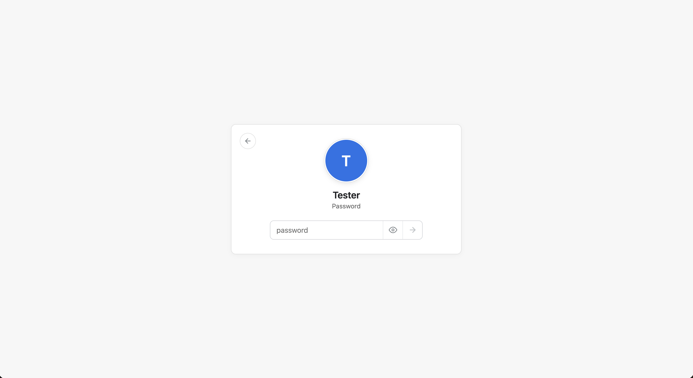
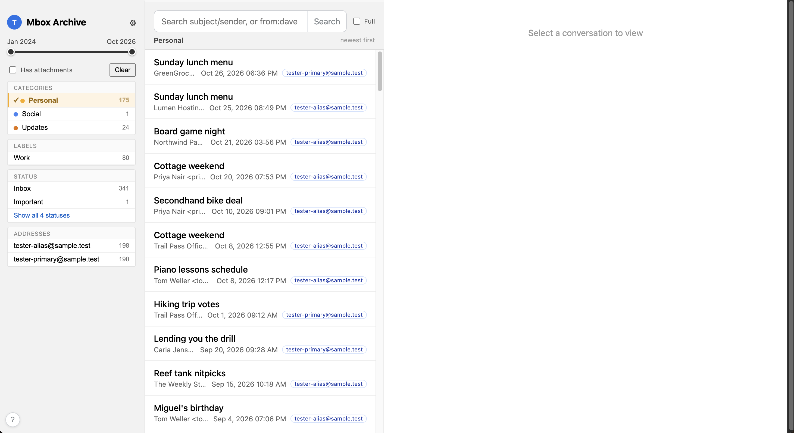
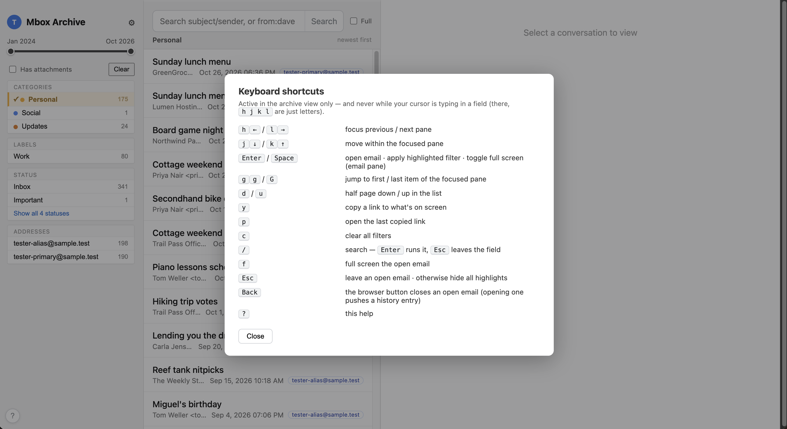
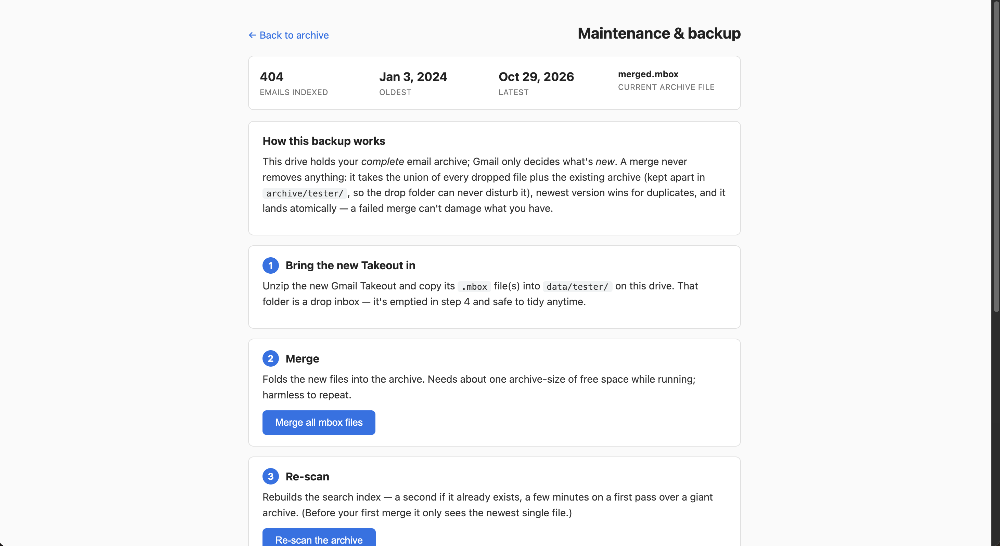
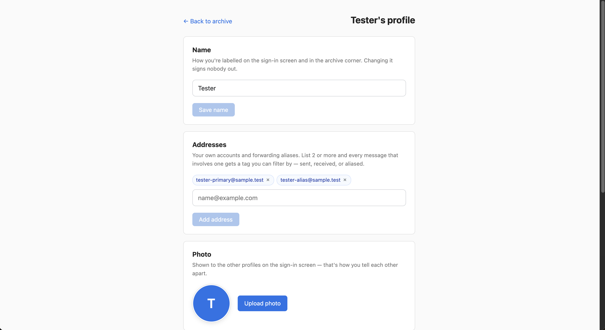

# 📬 Mbox Archive

Your old Gmail, on your own box.

Mbox Archive turns Gmail Takeout exports into a private, searchable web
reader for your household. Everyone gets their own login and their own
folder-scoped archive — nobody can see anyone else's mail. Drop `.mbox`
files into a folder, hit Merge and Re-scan, and years of email become a
fast threaded view with labels, facets and full-text search, reachable
from any device on your LAN. Nothing ever leaves home.

**It is a reader, not a mail server:** no sending, no receiving, no
syncing — it serves the archives you export. The whole app is two Docker
containers (a Rust/axum backend and a SvelteKit frontend) plus a handful
of bind-mounted folders.


## 📋 Contents

- [Features](#-features)
- [Installation](#-installation)
- [Daily use](#-daily-use)
- [Maintenance](#-maintenance)
- [Security & threat model](#-security--threat-model)
- [Contributing](#-contributing)
- [Credits](#-credits)
- [License](#-license)

## ✨ Features

- 🧑 **One archive per person** — separate folder, separate bcrypt-verified
  password, separate everything; the roster of profiles is the whole
  access model.
- 📥 **Gmail Takeout ingestion** — `.mbox` exports merge into one archive
  per person, with Message-ID dedup, so overlapping exports collapse into
  single copies instead of doubles.
- 🧵 **Threads, labels & facets** — conversations grouped by Gmail's
  `X-GM-THRID`; a filter sidebar with label, date, and identity facets.
- 🔍 **Fast full-text search** — the in-memory index takes roughly 500
  bytes per message (a 300k-message archive indexes in seconds, not
  minutes), and the search field understands `to:someone@else.com`-style
  queries.
- 🪪 **Multi-address identities** — declare several accounts or aliases and
  every message is tagged with the ones it involves; Gmail plus-aliases
  (`you+shopping@…`) collapse onto the base address automatically.
- ⌨️ **Vim-style keyboard flow** — `hjkl` between panes, `gg`/`G`, `d`/`u`,
  `/` to search, `y` to copy a permalink for what's on screen; press `?`
  in-app for the full cheat sheet.
- 🖼️ **Per-profile polish** — display name, portrait on the sign-in chooser,
  and a password change that instantly revokes every older session.
- 🗄️ **Verified, self-pruning backups** — gzip snapshots are
  decompression-checked before they count as done, and only the newest
  `N` are kept (`BACKUP_KEEP`, default 10).
- 🫥 **Small on purpose** — runs on Pi-class hardware; LAN-only by design
  (the honest caveats live in the [threat model](#-security--threat-model)).

## 🚀 Installation

**Where you run things.** Every command below is typed in a terminal *on
the machine that hosts the containers*, inside the cloned
`mbox-archive/` folder. Docker with Compose v2 is the only requirement —
even the profile bootstrap runs inside the app's own image, so nothing
depends on your host shell.

RAM scales with the archive (~500 bytes per message in the index; a
million messages ≈ 500 MB), on top of disk space for the mbox files.
Two people's full Takeouts run comfortably on a Pi-class box.

### 1. Clone

```sh
git clone https://github.com/ErCollao/mbox-archive.git
cd mbox-archive
```

### 2. Create the first profile

The backend refuses to start without at least one account (fail-closed),
so seed yourself first:

```sh
docker compose run --rm --build -v "$PWD/scripts:/scripts:ro" \
  backend bash /scripts/new-profile.sh daniel "Daniel"
```

The first run builds the two images (a few minutes, once). The script
then asks for the password twice — that is the login — and creates
`profiles/daniel/` and `data/daniel/` for you.

### 3. Start

```sh
docker compose up -d
```

First boot generates the cookie signing key and starts indexing. On very
large archives, wait for `Indexing complete` in
`docker compose logs backend`. Then open **http://localhost:3132** from
any device on your network: everyone picks who they are — each profile
sees only its own mail — and signs in with the password from step 2.




### 4. Import your mail

Request your exports at [takeout.google.com](https://takeout.google.com)
(Mail only), unzip, and copy the `.mbox` files into `data/daniel/`. Then
follow the in-app **⚙ maintenance page** — Merge → Re-scan → verify.
The full story, including what happens when exports overlap, is in
[Adding new mail](#adding-new-mail).

That's it. Reading mail starts now; household members are one script
away ([People & profiles](#people--profiles)).

## 🧭 Daily use

### Getting around

Three panes: filters on the left, conversations in the middle, the
reader on the right. You land on your primary category, like Gmail's
inbox; the sidebar offers categories, labels, status, date range,
"has attachments", and — when several addresses are declared — an
Addresses group. Rows show the thread, the newest sender, the date, and
chips marking which of your addresses the conversation involves.



Click or press Enter to open; a thread's messages navigate with `j`/`k`,
`f` makes it full screen, and browser Back (or `Esc`) steps out of the
email — not out of the app. `y` copies a permalink to whatever is on
screen; `p` reopens the last one.

### Searching

The search box covers subjects, senders and — with the `Full` toggle —
message bodies, over the whole index, instantly. `to:someone@else.com`
and `from:` terms work on their own; filters stay applied while you
search, so you can drill down inside a label or a date range. Press `c`
to clear every filter at once.


### Keyboard shortcuts

The whole view is driven without the mouse (in-app help: press `?` or
the bottom-left corner key). Keys never fire while you're typing in a
field — there, `hjkl` are just letters.



| Key | What |
|---|---|
| `h` `l` (or `←` `→`) | focus previous / next pane — the focused pane lifts with a shadow; the email pane also gets a blue frame |
| `j` `k` (or `↓` `↑`) | move within the focused pane (filters, emails, or thread messages) |
| `Enter` / `Space` | open email · apply highlighted filter · toggle full screen in the email pane |
| `gg` / `G` | jump to first / last item of the focused pane |
| `d` / `u` | half page down / up in the list (keeps loading more at the end, like `j`) |
| `y` / `p` | copy a link to what's on screen / open the last copied link |
| `c` | clear all filters |
| `/` | jump to the search field — `Enter` runs the search and hands the keys back; `Esc` leaves the field |
| `f` | full screen the open email |
| `Esc` | leave an open email; elsewhere hides all highlights (cursors remember their spots) |
| browser Back | closes an open email (opening a thread pushes a history entry, so Back steps out of the email, not out of the app) |
| `?` | this help |

### On the phone

Same archive, drawer-based layout — the filters slide in, the panes
stack, and there is no app store in the loop.


## 🧰 Maintenance

Everything that keeps the appliance alive rather than reading it: new
mail flowing in, the household roster in order, and copies of it all
that survive a dead disk. It runs through the in-app **⚙ maintenance
page** and two small scripts.

### Adding new mail

Getting new mail in is a deliberate two-move ritual, not a sync — and
that's what makes it safe.

1. **Export.** [takeout.google.com](https://takeout.google.com) →
   deselect everything → Mail → create export → download the zip →
   unzip. You get one or more `.mbox` files (big archives are split into
   `mbox-1.mbox`, `mbox-2.mbox`, …).
2. **Drop.** Copy them into `data/<you>/` — the drop inbox. As many
   files and as many rounds as you like. Nothing in `data/` is ever
   auto-deleted, and nothing you drop there can damage what's already
   archived.
3. **Run the ⚙ maintenance page, in order.** It is a per-profile
   runbook with your real folder names filled in:



#### Overlaps are taken care of

Gmail exports generations of the same mail — your old Takeout from
2022 and today's will both contain thousands of the same messages, and
two accounts of yours exchanged copies of every thread between them.
**Merge sorts that out by itself:**

- Every message keeps its Gmail `Message-ID`; Merge folds `data/` plus
  the existing archive into one `archive/merged.mbox` and **collapses
  duplicates to a single newest copy**. The log reports exactly how
  many were skipped.
- Mail *you sent from account A to account B* existed twice in the
  exports — after dedup it is one message inside one conversation,
  tagged with both addresses. No "double threads".
- Merge **only adds**: it never removes anything from the archive, it
  writes to a temp file and renames atomically (an interrupted merge
  cannot corrupt the archive), and it is safe to repeat as often as you
  like.
- After a merge, **Re-scan** rebuilds the index (seconds to a minute,
  even for big archives). Until your first Merge the boot scan indexes
  only the newest single mbox file — the runbook warns you when that's
  the case; Merge + Re-scan is always the complete answer.

#### Verify, then tidy

The stats row up top tells you what's live: message count (should be ≥
last time) and the newest date (should match your new export). Search
for a message you know is in it. Only once you're happy, empty
`data/<you>/` — everything is in the archive now. The **Backup** button
at the bottom of the runbook snapshots the archive and keeps the ten
newest verified copies; how that fits into real redundancy is in
[Backups & retention](#backups--retention).

### People & profiles

Adding someone = one script; it works everywhere via docker. From the
repo folder on the host machine:

#### Adding a person

```sh
docker compose run --rm -v "$PWD/scripts:/scripts:ro" \
  backend bash /scripts/new-profile.sh hajni "Hajni"
docker compose restart backend
```

The script prompts for the password twice, writes
`profiles/hajni/profile.json` and creates the folders; the restart
loads them. Hajni now appears on the sign-in chooser, signs in, and can
set name, portrait and addresses in **Settings**. On Linux/macOS hosts
you can skip the docker wrapper and run `./scripts/new-profile.sh hajni`
directly — it detects where it is.

(The seeded secret is a sha256 hash; the first successful login upgrades
it to bcrypt automatically. Nothing to do.)

#### Removing a person

```sh
docker compose run --rm -v "$PWD/scripts:/scripts:ro" \
  backend bash /scripts/delete-profile.sh hajni
docker compose restart backend
```

The script removes the login (secret, addresses, portrait) and then
offers to delete the mail too — showing the size it would free — never
without an explicit yes. `--purge` does profile and mail in one go,
guarded by typing the username. The restart revokes old session cookies
of the removed person (if they were the last profile, the backend
deliberately won't boot until a new one exists).

#### Names, passwords & portraits

The avatar chip opens Settings: display name, password, portrait
(JPEG/PNG/WebP, ≤12 MB, cropped to a 512px square, shown on the sign-in
chooser). Changes are written straight to the profile and take effect
immediately — no restart, and a rename never logs anyone out.



Changing the **password** is the revoke switch: session cookies carry a
fingerprint of the secret they were issued against, so every older
session dies the moment the password changes — your current device just
stays signed in. Deleting `archive/session.key` instead logs everyone
out at once.

#### Multiple accounts & aliases

One person can declare several identities — separate Gmail accounts
merged into one archive, or aliases that forward into it — under
**addresses** in Settings (lowercase, max 30). With two or more declared:

- every email row gets a chip listing which of your addresses it
  involves (`from`, `to`, or `cc`), and the sidebar grows an
  **Addresses** filter group;
- with 0 or 1, everything stays exactly as before — no chips, no group.

Worth knowing: chips are derived at read time from already-indexed
headers — adding an address relabels the whole archive instantly, no
rescan, and removing one forgets it cleanly. Gmail plus-aliases collapse
(`hajni+news@gmail.com` counts as `hajni@gmail.com` unless the exact
plus-address is declared). And merging two accounts' exports is just
[Adding new mail](#adding-new-mail) twice: duplicates across the two
Takeouts collapse into single messages inside shared threads.

### Backups & retention

The runbook's Backup button writes verified gzip snapshots into
`backup/<slug>/` (temp file → full decompression check → atomic
rename; a partial or corrupt backup never appears as a completed one).
It keeps the ten newest `mbox-archive-*.mbox.gz` per profile
automatically — tune with `BACKUP_KEEP` on the backend service; `0`
disables pruning. For that to mean anything, `BACKUP_DIR` should point
at a different physical disk than the archive. Nothing *schedules*
backups yet: a nightly `tar czf snapshot.tgz backup/ profiles/ archive/`
cron (or a Synology task) covers the whole tree. `profiles/` is small
and precious — it is the password hashes and address lists.

### Updates & health

**Update:** `git pull && docker compose up -d --build`. All state lives
in bind-mounted folders outside the images, so updating — or rolling
back — never touches anyone's mail.

**Stay healthy:** both services carry healthchecks (`docker compose ps`
should say `healthy`); `docker compose logs -f backend` shows indexing,
merge and backup milestones; the frontend waits for a healthy backend
before starting.

## 🔐 Security & threat model

**LAN-only by design.** One password per household member — each
person's login opens only their own archive, nobody shares credentials —
bcrypt-verified over plain HTTP behind the home router. This is a family
appliance, not a vault. **Don't put this on the open internet as-is:**
the app ships no TLS, no Secure cookie flag, no rate limiting, and no
account lockout. For remote access, terminate TLS in a reverse proxy
(Caddy/nginx) *and* add authentication in front.

Sessions are HMAC-signed year cookies carrying `slug:expiry:fingerprint`
(`archive/session.key`); delete that file to log everyone out at once,
or change a password to evict just that one person's older sessions.
Cookies are `HttpOnly; SameSite=Lax`; the API sends no CORS headers at
all, so other websites cannot ride a logged-in user's cookie. Email HTML
is served with a `sandbox` CSP and rendered in a scriptless sandboxed
iframe; attachment previews downgrade markup types to plain downloads.

Known and accepted: profile names and portraits are readable without
login (the sign-in chooser needs it), and there is no login rate
limiting or lockout — acceptable next to "anyone on the LAN could just
unplug the disk".

## 🤝 Contributing

Repo and runtime data layout, the module map (session format, merge &
backup mechanics, XSS posture), test suites, the disposable `test-env/`,
the demo corpus generator and screenshot conventions all live in
**[CONTRIBUTING.md](CONTRIBUTING.md)**. The short version:

```sh
cd frontend && npm test          # vitest
./test-env/up.sh                 # disposable full stack on :3199 — verify here, never on live data
```

CI enforces `cargo clippy --all-targets -- -D warnings` + `cargo test` +
`npm test` + production build on every push.

## 🙏 Credits

All mbox heavy lifting comes from [mboxshell](https://github.com/dcarrero/mboxshell)
(MIT): parsing Gmail Takeout exports, the on-disk binary message index,
and full-text search. Built on top of it: thread grouping by
`X-GM-THRID`, facet counts and the filter language, identity/address
tagging, the archive lifecycle (merge → scan → backup), and the entire
web UI.

## 📄 License

[MIT](LICENSE.md) — free to use, modify, and share, with attribution.
