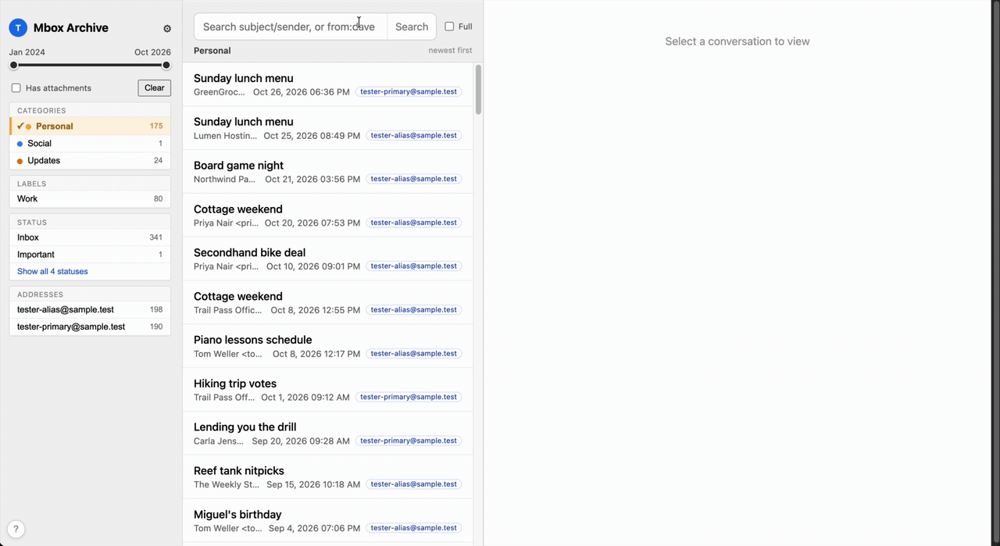
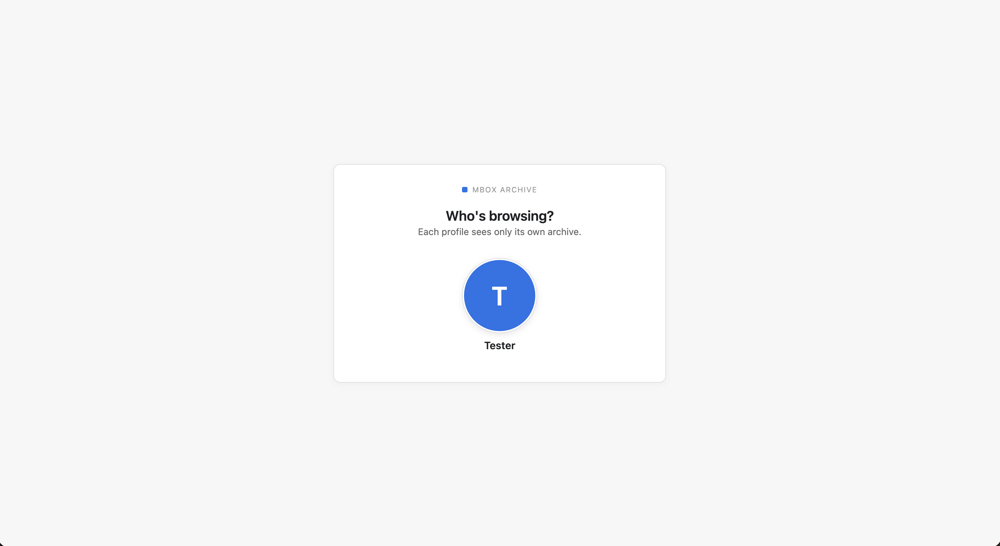
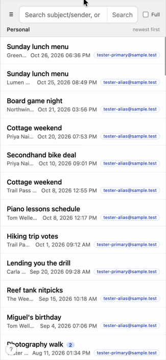

# 📬 Mbox Archive

Your old Gmail, on your own box.

Mbox Archive turns Gmail Takeout exports into a private, searchable web
reader for your household. Everyone gets their own login and their own
folder-scoped archive — nobody can see anyone else's mail. Drop `.mbox`
files into a folder, hit Merge and Re-scan, and years of email become a
fast threaded view with labels, facets and full-text search, reachable
from any device on your LAN. Nothing ever leaves home.

**It is a reader, not a mail server:** no sending, no receiving, no
syncing — it serves the archives you export. The whole app is two Docker
containers (a Rust/axum backend and a SvelteKit frontend) plus a handful
of bind-mounted folders.



## 📋 Contents

- [Features](#-features)
- [Installation](#-installation)
- [Daily use](#-daily-use)
- [Keyboard shortcuts](#-keyboard-shortcuts)
- [Data layout](#-data-layout)
- [Operations](#-operations)
- [Testing](#-testing)
- [Security & threat model](#-security--threat-model)
- [Credits](#-credits)
- [License](#-license)

## ✨ Features

- 🧑 **One archive per person** — separate folder, separate bcrypt-verified
  password, separate everything; the roster of profiles is the whole
  access model.
- 📥 **Gmail Takeout ingestion** — `.mbox` exports merge into one archive
  per person, with Message-ID dedup, so overlapping exports collapse into
  single copies instead of doubles.
- 🧵 **Threads, labels & facets** — conversations grouped by Gmail's
  `X-GM-THRID`; a filter sidebar with label, date, and identity facets.
- 🔍 **Fast full-text search** — the in-memory index takes roughly 500
  bytes per message (a 300k-message archive indexes in seconds, not
  minutes), and the search field understands `to:someone@else.com`-style
  queries.
- 🪪 **Multi-address identities** — declare several accounts or aliases and
  every message is tagged with the ones it involves; Gmail plus-aliases
  (`you+shopping@…`) collapse onto the base address automatically.
- ⌨️ **Vim-style keyboard flow** — `hjkl` between panes, `gg`/`G`, `d`/`u`,
  `/` to search, `y` to copy a permalink for what's on screen; press `?`
  in-app for the full cheat sheet.
- 🖼️ **Per-profile polish** — display name, portrait on the sign-in chooser,
  and a password change that instantly revokes every older session.
- 🗄️ **Verified, self-pruning backups** — gzip snapshots are
  decompression-checked before they count as done, and only the newest
  `N` are kept (`BACKUP_KEEP`, default 10).
- 🫥 **Small on purpose** — runs on Pi-class hardware; LAN-only by design
  (the honest caveats live in the [threat model](#-security--threat-model)).

## 🚀 Installation

### What you need

- **Docker with Compose v2** — that's the entire runtime.
- **A machine on your home network** — RAM scales with the archive: the
  in-memory index keeps roughly 500 bytes per message (1M messages
  ≈ 500 MB) on top of disk space for the mbox files. Two people's full
  Takeouts run comfortably on a few-GB Pi-class box.
- **Your Takeout exports** — request them at [takeout.google.com](https://takeout.google.com);
  the Mail download gives you `.mbox` files (often gzipped — unzip first).

### 1. Clone the repo

```sh
git clone https://github.com/ErCollao/mbox-archive.git
cd mbox-archive
```

### 2. Bootstrap a profile

The backend deliberately refuses to start with zero valid profiles
(fail-closed), so create yourself first:

```sh
./scripts/new-profile.sh daniel "Daniel"
```

The script prompts for the password twice, creates `profiles/daniel/`
and `data/daniel/`, seeds `profile.json` with a sha256 secret — the
first successful login transparently upgrades it to bcrypt — and
restarts the backend if the stack is already up. (Adding anyone else
later is the same one-liner, see [Daily use](#-daily-use).)

Prefer by hand, or running on a box without the script? The seed hash
is just `sha256(password)` in lowercase hex:

```sh
printf '%s' 'the password' | shasum -a 256 | cut -d' ' -f1   # or sha256sum
```

...then write `profiles/daniel/profile.json` yourself:

```json
{ "name": "Daniel", "secret": "<the sha256 hex from above>" }
```

Docker-only host (no bash/shasum handy)? Run the script inside the image
instead — it works before the first `up -d` (it builds the image as a
side effect):

```sh
docker compose run --rm --build -v "$PWD/scripts:/scripts:ro" backend bash /scripts/new-profile.sh daniel "Daniel"
```

Then continue with step 3.

### 3. Start the containers

```sh
docker compose up -d --build
```

First boot auto-creates `archive/session.key` (the cookie signing key)
and indexes every profile's newest mbox. On very large archives, wait
for `Indexing complete` in `docker compose logs backend`. The frontend
holds off until the backend reports healthy.

Open `http://localhost:3132`: everyone on the LAN picks who they are —
each profile sees only its own archive.




### 4. Import your mail

Copy the Takeout `.mbox` files into your inbox folder — `data/you/` —
as many files as Takeout gave you. Then in the app:

1. Open [http://localhost:3132](http://localhost:3132) (the `/welcome`
   page gates everything else) and sign in.
2. Click the **⚙ maintenance page** — the per-profile runbook:
   **Merge** (folds `data/` into `archive/merged.mbox`, deduping by
   Message-ID) → **Re-scan** (rebuilds the index) → check the verified
   counts → **Backup** when it looks right.

The runbook spells out the real folder names at each step, so you can
follow it without reading this README again.


### 5. Personalize

Sign in and open the avatar chip (top-left) → `/profile`: set your
display name, change the password to bcrypt-backed strength, and upload
a portrait (JPEG/PNG/WebP, ≤12 MB — cropped to a 512px square in the
browser and shown on the sign-in chooser). Changes hit
`profiles/you/profile.json` immediately; no restart, and a rename never
logs anyone out.


## 🧭 Daily use

New mail is the same loop: drop files into `data/<slug>/`, then Merge →
Re-scan from the ⚙ page. Browsing, searching and filtering happen in the
archive view; the [keyboard shortcuts](#-keyboard-shortcuts) make it
quick.

The archive view is three panes — facets, threads, reader — and lands on
your primary category like Gmail does:


Search is instant full-text over subjects and bodies (press `Enter` to
run it); clicking a hit opens the thread — grouped by Gmail's own id —
with the messages navigable via `j`/`k`:


And it fits your phone — the same archive, drawer-based layout, no app
store required:



### Adding or removing a person

Two helper scripts do the whole job — password prompt, folders, profile
seed, backend restart. Run them on the machine hosting the stack, from
the folder you cloned:

```sh
./scripts/new-profile.sh hajni "Hajni"    # prompts twice for the password
./scripts/delete-profile.sh hajni         # removes the login; then offers to
                                          # delete the mail too (size shown
                                          # before you say yes; mail is never
                                          # removed without an explicit yes)
./scripts/delete-profile.sh hajni --purge # profile + data/ + archive/ + backup/
                                          # in one go, typed-username confirmed
```

**Docker-only hosts** (Windows, Synology — anywhere you'd rather not rely on
host bash): run the same scripts *inside* the backend container. The
bind-mounted folders mean the effect is identical; just restart after:

```sh
docker compose run --rm --build -v "$PWD/scripts:/scripts:ro" backend bash /scripts/new-profile.sh hajni "Hajni"
docker compose run --rm --build -v "$PWD/scripts:/scripts:ro" backend bash /scripts/delete-profile.sh hajni
docker compose restart backend
```

New people sign in and personalize their name, portrait and addresses
under `/profile`. Removing takes effect immediately because the scripts
restart the backend — old session cookies of a removed profile die with
the roster rebuild. By hand it's the same two moves: delete
`profiles/<slug>/`, restart; `data/` and `archive/` stay until you wipe
them.

### Multiple accounts & aliases

One person can declare several identities — separate Gmail accounts
merged into one archive, or aliases that forward into it — under
**your own addresses** in `/profile` (stored as `"addresses": [...]` in
`profile.json`, lowercase, max 30). With **two or more** declared:

- every email row gets a tag listing which of your addresses it involves
  (`from`, `to`, or `cc`), and the sidebar grows an **Addresses** filter
  group;
- with 0 or 1, everything stays exactly as before — no tags, no group.

Mechanics worth knowing:

- Tags are **derived at read time** from already-indexed header fields.
  They are never written into the mbox or the index — adding an address
  relabels the whole archive instantly (no rescan), removing one forgets
  it cleanly.
- Gmail plus-aliases collapse: `you+news@gmail.com` counts as
  `you@gmail.com` unless the exact plus-address is itself declared
  (most-specific wins).
- Merging separate Takeout exports just works: drop the `.mbox` files in
  `data/<slug>/`, Merge, Re-scan. Mail that two of your accounts
  exchanged exists once per copy with an identical Message-ID — dedup
  collapses each message to a single copy, so mutual threads merge into
  one conversation (tagged with both addresses), not two duplicates.
- The search field also accepts `to:hajni@work.com`-style queries on its
  own.

### Changing the password (and evicting sessions)

Changing the *password* is the revoke switch: session cookies carry a
fingerprint of the secret they were issued against, so every older
session dies the moment the password changes (your current one is
re-issued automatically).

### Backups & retention

The ⚙ maintenance page produces verified gzip snapshots into
`backup/<slug>/`: written to a temp file, decompression-checked in
full, then atomically renamed — a partial or corrupt backup never
appears as a completed one. After each successful backup, all but the
ten newest `mbox-archive-*.mbox.gz` are pruned automatically (tune with
`BACKUP_KEEP` in the environment; `0` disables pruning).

Nothing *schedules* backups yet — a nightly `tar czf backup-snapshot.tgz
backup/ profiles/ archive/` cron (or a Synology task) on the host
covers it. `profiles/` is small and precious: it holds the password
hashes and address lists.

## 💻 Keyboard shortcuts

Vim-style navigation in the archive view (in-app help: press `?` or the
bottom-left corner key). Keys never fire while you're typing in a field —
there, `hjkl` are just letters.


| Key | What |
|---|---|
| `h` `l` (or `←` `→`) | focus previous / next pane — the focused pane lifts with a shadow; the email pane also gets a blue frame |
| `j` `k` (or `↓` `↑`) | move within the focused pane (filters, emails, or thread messages) |
| `Enter` / `Space` | open email · apply highlighted filter · toggle full screen in the email pane |
| `gg` / `G` | jump to first / last item of the focused pane |
| `d` / `u` | half page down / up in the list (keeps loading more at the end, like `j`) |
| `y` / `p` | copy a link to what's on screen / open the last copied link |
| `c` | clear all filters |
| `/` | jump to the search field — `Enter` runs the search and hands the keys back; `Esc` leaves the field |
| `f` | full screen the open email |
| `Esc` | leave an open email; elsewhere hides all highlights (cursors remember their spots) |
| browser Back | closes an open email (opening a thread pushes a history entry, so Back steps out of the email, not out of the app) |
| `?` | this help |

## 📁 Data layout

All runtime directories are gitignored and bind-mounted into the backend
container — which means updates and rollbacks are stateless, and you can
back the whole app up by copying this tree:

```
profiles/<slug>/profile.json   roster: { "name": "...", "secret": "<bcrypt hash>" }
profiles/<slug>/portrait.jpg   optional (also .jpeg/.png/.webp) — shown on the login chooser
data/<slug>/                   drop inbox: copy new Takeout .mbox files here
archive/<slug>/merged.mbox     the accumulated archive (created by Merge)
archive/session.key            cookie signing key, auto-generated on first boot
backup/<slug>/                 gzip backups from the maintenance page
```

A broken `profile.json` only skips that one profile — it never takes
others down.

## 🔧 Operations

**Updates:** `git pull && docker compose up -d --build`. All state lives
in the bind-mounted folders above, so updating — or rolling back — never
touches anyone's mail.

**Health & logs:** both services carry healthchecks — `docker compose ps`
should show `healthy`. `docker compose logs -f backend` shows indexing,
merges and body-scan milestones; the frontend waits for the backend to
be healthy before starting.

## 🧪 Testing

Automated suites (no containers involved):

```sh
cd frontend && npm test                       # vitest + @testing-library/svelte
docker run --rm -v "$PWD/backend:/usr/src/app" -w /usr/src/app rust:slim cargo test
```

Browser verification happens **only** against the disposable test
environment — never against the live app on :3132, and never with the
live profiles:

```sh
./test-env/up.sh                              # fixture-only stack on :3199 (API :8199)
# login: tester / testpass — profile.json + sample.mbox are seeded from fixtures/
./test-env/down.sh
```

`test-env/` runs as its own compose project (`-p mbxtest`) with its own
volumes, ports, and profiles; its runtime dirs are gitignored. The
fixture `demo.mbox` (400 fictional messages, all addresses on the
reserved `.test` TLD) is seeded automatically for screenshots and
manual checks — regenerate with `python3 test-env/fixtures/make-demo-mbox.py`.
The live `profiles/`, `data/`, `archive/` folders are user data — treat
them as production: read-only, or don't touch.

## 🔐 Security & threat model

**LAN-only by design.** One password per household member — each person's
login opens only their own archive, nobody shares credentials —
bcrypt-verified over plain HTTP behind the home router. This is a family
appliance, not a vault. **Don't put this on the open internet as-is:** the app ships no
TLS, no Secure cookie flag, no rate limiting, and no account lockout.
For remote access, terminate TLS in a reverse proxy (Caddy/nginx) *and*
add authentication in front.

Sessions are HMAC-signed year cookies carrying `slug:expiry:fingerprint`
(`archive/session.key`); delete that file to log everyone out at once,
or change a password to evict just that one person's older sessions.
Cookies are `HttpOnly; SameSite=Lax`; the API sends no CORS headers at
all, so other websites cannot ride a logged-in user's cookie. Email HTML
is served with a `sandbox` CSP and rendered in a scriptless sandboxed
iframe; attachment previews downgrade markup types to plain downloads.

Known and accepted: profile names and portraits are readable without
login (the sign-in chooser needs it), and there is no login rate
limiting or lockout — acceptable next to "anyone on the LAN could just
unplug the disk".

## 🙏 Credits

All mbox heavy lifting comes from [mboxshell](https://github.com/dcarrero/mboxshell)
(MIT): parsing Gmail Takeout exports, the on-disk binary message index,
and full-text search. Built on top of it: thread grouping by
`X-GM-THRID`, facet counts and the filter language, identity/address
tagging, the archive lifecycle (merge → scan → backup), and the entire
web UI.

## 📄 License

[MIT](LICENSE.md) — free to use, modify, and share, with attribution.
